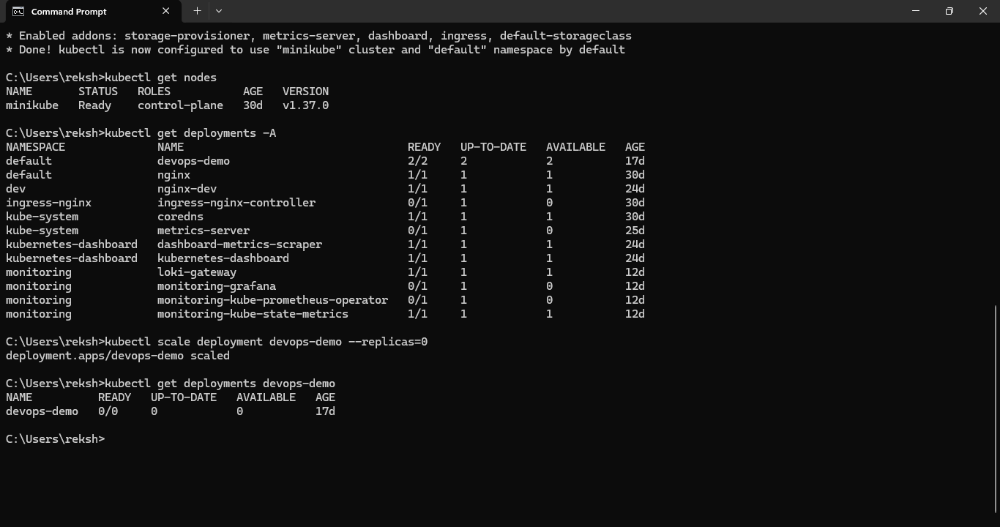
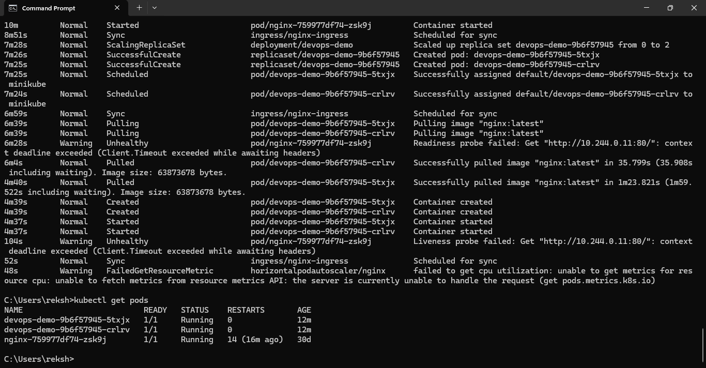

# Incident 01: Service Downtime and Recovery

## 1. Incident Summary
A planned service downtime was simulated in a local Kubernetes test environment using Minikube.

## 2. Environment
- Platform: Kubernetes
- Cluster: Minikube
- Deployment: `devops-demo`
- Namespace: `default`
- Container image: `nginx:latest`

## 3. Incident Simulation
The deployment was scaled from two replicas to zero replicas to simulate service downtime.

Command used:

```bash
kubectl scale deployment devops-demo --replicas=0
```
The deployment status was checked to verify that no replicas were running.

## 4. Root Cause
The service became unavailable because the deployment was intentionally scaled to zero replicas during the controlled test.

## 5. Recovery Procedure
The deployment was scaled back to two replicas.

Command used:

```bash
kubectl scale deployment devops-demo --replicas=2
```
The pods were checked and the deployment was inspected to confirm recovery.

## 6. Verification
The deployment status showed:
- Desired replicas: 2
- Available replicas: 2
- Unavailable replicas: 0

Container logs showed that NGINX completed its configuration and started its worker processes.

 ## 7. Evidence

### Service Downtime


### Service Recovery


## 8. Preventive Measures
- Monitor replica counts and pod readiness.
- Restrict unintended scaling changes.
- Configure alerts for unavailable replicas.
- Verify service health after recovery.

## 9. Result
The controlled downtime simulation and recovery verification were completed successfully.
